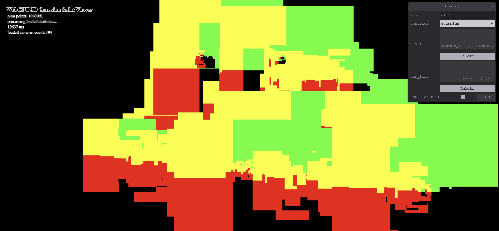
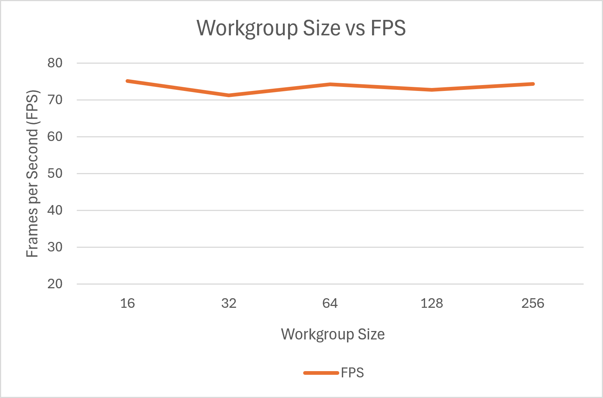
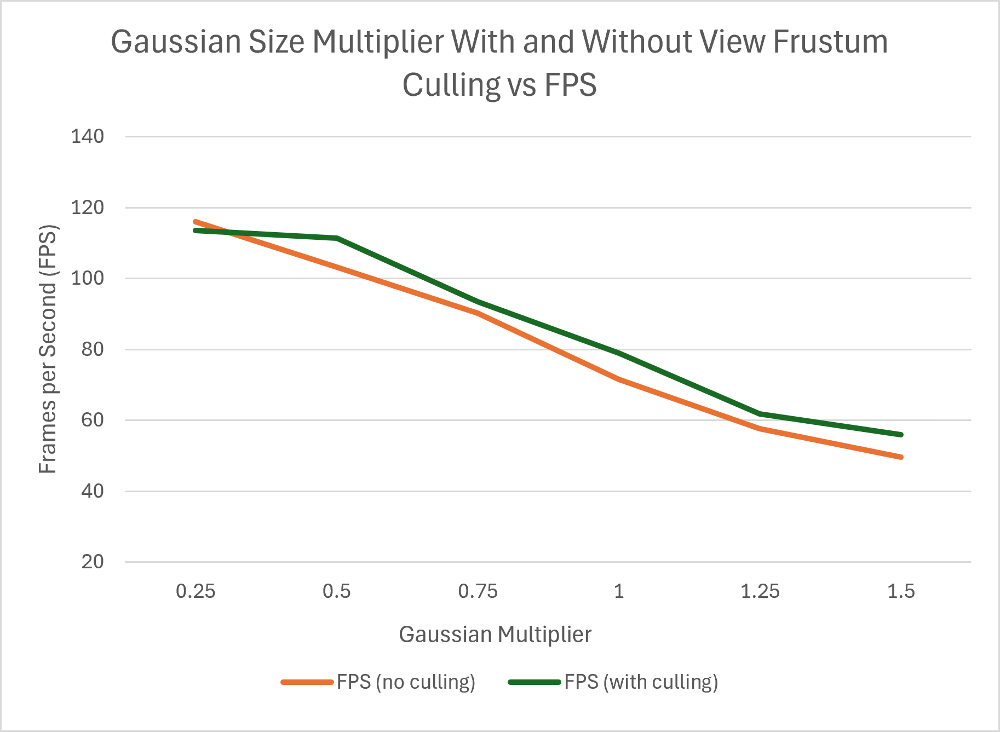
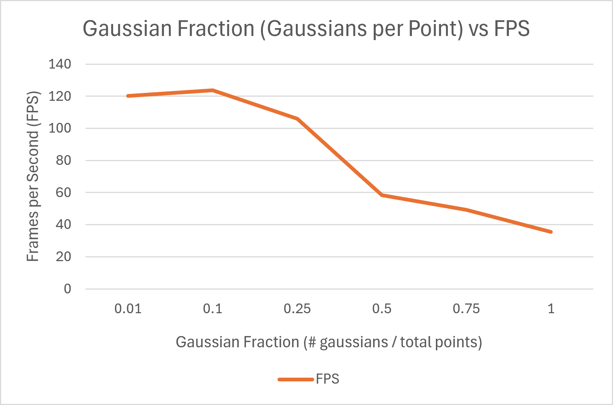

# Project5-WebGPU-Gaussian-Splat-Viewer

**University of Pennsylvania, CIS 565: GPU Programming and Architecture, Project 5**

* Darrel Dsouza
* Tested on: Windows 11, i7-12700 @ 2.1GHz 32GB, NVIDIA T1000 4096MB (CETS Lab)

### Github pages

[Live Demo - Github Pages](https://darreld081.github.io/Project5-WebGPU-Gaussian-Splat-Viewer/)

### Demo Video/GIF

[Recording Part 1](img/demo_p1.mp4)
[Recording Part 2](img/demo_p2.mp4)

## Overview

A WebGPU viewer for pretrained 3D Gaussian Splatting scenes. This viewer has two renderers that one can switch between at runtime - a simple point cloud and the full gaussian splat renderer.

## Features

**Point Cloud Renderer**

**Gaussian Splat Renderer**
- **Preprocess compute shader** 
- **Radix sort**
- **Indirect draw**
- **Fragment shader**
- **Render settings buffer**

## Images and Performance Analysis

**Final renders** (`bicycle_30000.cleaned.ply`, default camera, blended splats). These renders show image quality and characteristics at various levels of gaussian multipliers (0.2, 0.8, 1.2, 1.5).

| **0.2** | **0.8** |
|---|---|
|  |  |
| **1.2** | **1.5** |
|  |  |

- At **0.2** the gaussians are tiny, so individual splats are visible as a speckled point-like surface with gaps between individual gaussians.
- At **0.8** they overlap but do not over-smooth, resulting in a sharp image
- At **1.2** the image is smooth and close to the source photographs.
- At **1.5** the gaussians are oversized, and the image gets soft on the edges and blurry

**Quad Renders** To generate this, the coordinates were drawn as `(d.x, d.y, 0, 1)` for each quad. Offsets are in pixels, so the colors separate into red, green, yellow and black quadrants.

In the code, the showOffset flag in the gaussian shader (src/shaders/gaussian.wgsl) can be used to enable and disable quad debug rendering.

## Performance Analysis

A performance analysis was conducted to determine the effects of workgroup size, view frustum culling and number of gaussians on graphics performance (Frames per Second or FPS) When not explicitly mentioned, workgroup size defaulted to 128, view frustum culling was turned off, gaussian fraction was 0.5 and gaussian multipler was 0.5. This is to maintain a consistent starting point for these comparisons.

**Workgroup size**

It can be seen that as workgroup size increases, FPS remains flat from 16 to 256 (about 71 to 75), Any minor difference are likely due to random noise and are not significant.

**View-frustum culling**

Culling helps slightly vs no view frustum culling. When view frustum culling is enabled, we see a jump of on average 4 FPS at almost all gaussian multipliers - about 79 vs 71 FPS at a 1.0 gaussian multiplier and about 56 vs 50 at 1.5 gaussian multiplier. At 0.25 the two lines are not significantly different. These results are most likely driven by the fact that in the default view that was used to collect these measurements, the majority of the scene was within the camera frustum, so fairly little was actually culled. If a more zoomed in view was used, one would expect these values to be more distinct.

**Number of gaussians**

Gaussian fraction represents the fraction of total points in the point cloud that the gaussian splat is calculated for. FPS remains relatively high at low gaussian fractions and drops precipitously between 0.25 and 0.5. The flatness of the curve below 0.1 is likely due to the display refresh rate capping the FPS to 120.

## Credits
- [Vite](https://vitejs.dev/)
- [tweakpane](https://tweakpane.github.io/docs//v3/monitor-bindings/)
- [wgpu-matrix](https://github.com/greggman/wgpu-matrix)
- [3D Gaussian Splatting notes (kwea123)](https://github.com/kwea123/gaussian_splatting_notes) and the [Differential Gaussian Rasterization](https://github.com/graphdeco-inria/diff-gaussian-rasterization) reference for the covariance, conic and radius math.
